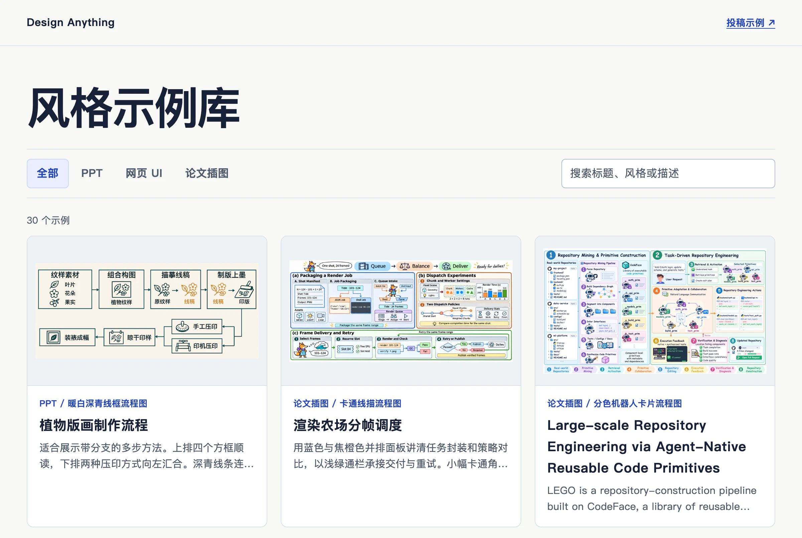
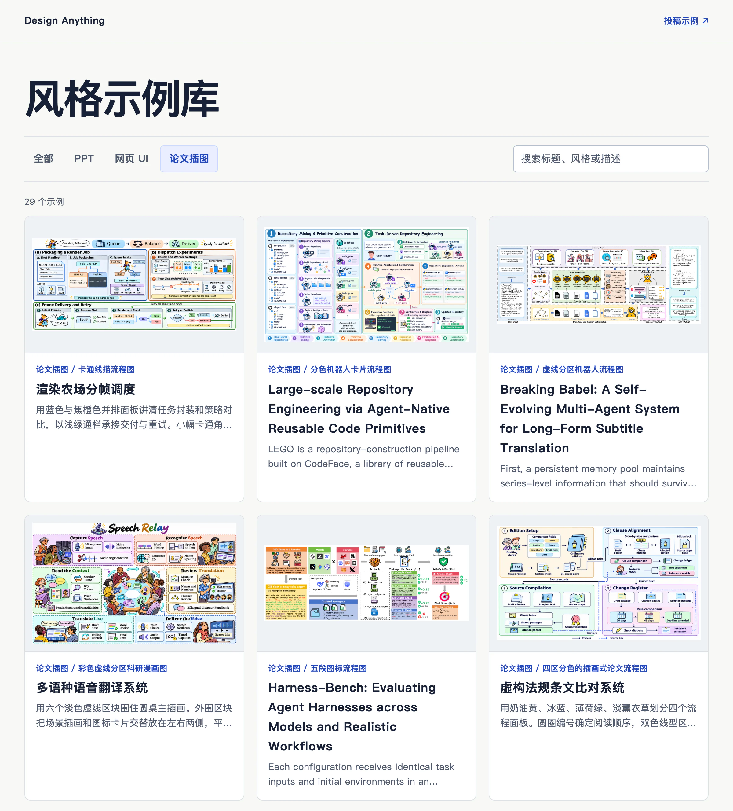
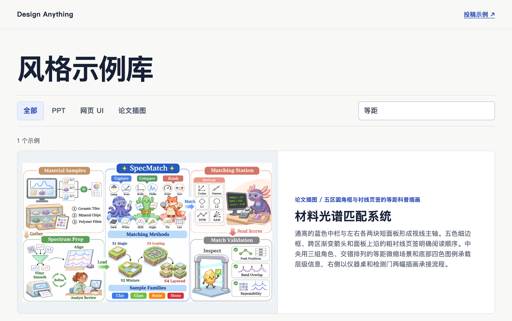
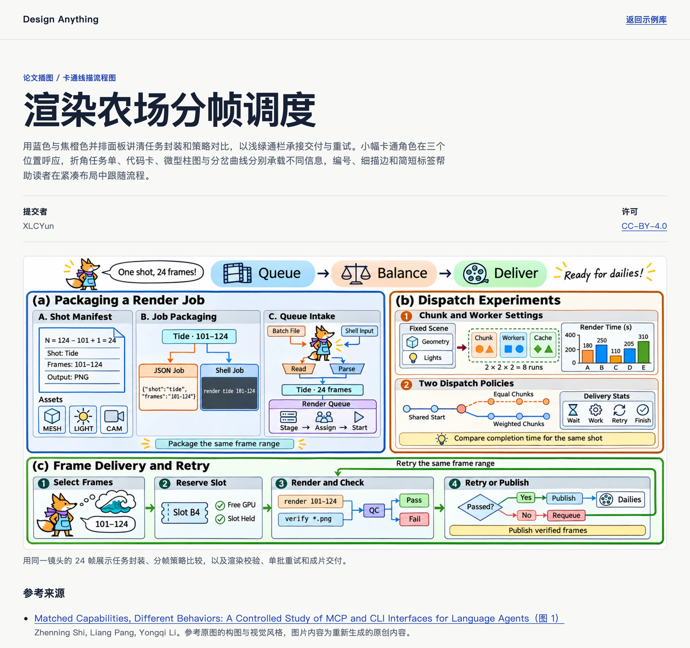

# Design Anything 风格示例

这里收录社区用 Design Anything 做出的 PPT、网页界面和论文插图示例。每条示例附预览图、用途和可借用的视觉特征。按需浏览单个示例即可。[Design Anything Skill](https://github.com/XLCYun/cangyun-design-anything)

在线图集支持按类别浏览和关键词搜索，示例合并到 `main` 后会自动更新。[浏览图集](https://xlcyun.github.io/cangyun-design-anything-examples/)



点选「论文插图」，即可浏览这一类别的示例。



搜索「等距」，可以找到「材料光谱匹配系统」。



| 类别 | 目录 |
| --- | --- |
| PPT | [examples/ppt](examples/ppt/) |
| 网页 UI | [examples/ui](examples/ui/) |
| 论文插图 | [examples/paper](examples/paper/) |

按类别、风格和示例分目录。同一风格可以收录多个示例，每条示例可以包含多张图。

```text
examples/
  ppt/
    russian-constructivism/
      fudan-intro/
        example.json
        images/
          01-cover.webp
          02-content.webp
  ui/
  paper/
```

`example.json` 记录标题、描述、作者、许可和有序的图片列表。第一张图作为预览封面。[元数据格式](schemas/example.schema.json)

其中 `author` 填写提交者，详情页显示为「提交者」。原作者的署名写在 `references` 的 `credit` 字段中。

点开示例可查看完整说明、提交者、许可和预览图。有参考作品时，页面也会列出来源。



欢迎分享一份可公开的示例。用表单上传预览图和说明，校验通过后会自动生成草稿 PR，供维护者审核。[投稿表单](https://github.com/XLCYun/cangyun-design-anything-examples/issues/new?template=style-example.yml) · [贡献说明](CONTRIBUTING.md)
